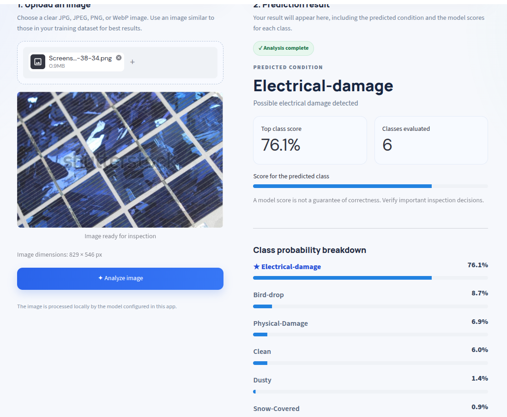
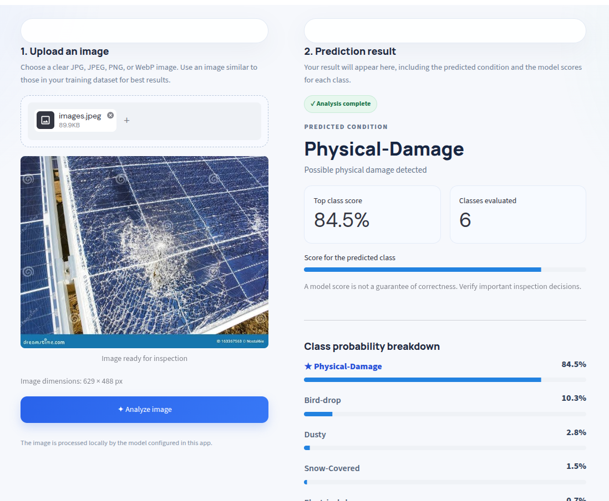

<div align="center">

# Solar Panel Condition Classification

**Deep Learning · EfficientNetB0 · Streamlit · AWS EC2**

An end-to-end computer-vision application that classifies solar-panel images into six visible condition categories and presents predictions through an interactive web interface.

<p>
  
  
  
</p>

<em>Example predictions from the application: low-confidence electrical damage, electrical damage under reflections/shadows, and visible physical damage.</em>

</div>

---

## At a Glance

| | |
|---|---|
| **Problem** | Image-based screening of solar-panel conditions |
| **Model** | EfficientNetB0 with TensorFlow / Keras |
| **Interface** | Streamlit web application |
| **Classes** | 6 condition categories |
| **Cloud deployment** | Amazon EC2 · Linux · `us-east-1` |
| **Experiments** | Keras Tuner hyperparameter-search experiments |
| **Repository** | [MrAvishek/Panel-Classifier](https://github.com/MrAvishek/Panel-Classifier) |

> **Screenshots:** The gallery above expects three files in an `images/` directory. Add your actual application screenshots using the filenames shown, or update the image paths to match your repository. GitHub will display them side by side at the top of the README.

## Project Overview

Solar panels can be affected by dust, bird droppings, snow, and physical or electrical damage. This project explores deep-learning-based image classification as a first-pass way to identify a panel's visible condition.

A user uploads an image through the Streamlit interface. The application preprocesses the image, runs inference with a trained EfficientNetB0 classifier, and displays the predicted category and class probabilities. The application is deployed on an AWS EC2 Linux instance.

The project brings together a complete applied-ML workflow: image classification, model experimentation, an interactive UI, dependency management, version control, and cloud deployment.

## Example Predictions

| Example | Image observation | Predicted class | Confidence |
|---|---|---|---:|
| 1 | A panel cell with a discolored or burned-looking patch | `Electrical-damage` | **32.1%** |
| 2 | A panel with reflections and shadows across the surface | `Electrical-damage` | **76.1%** |
| 3 | A severely cracked and shattered panel | `Physical-Damage` | **84.5%** |

The first result is a useful reminder that the highest-scoring class is not necessarily a reliable conclusion. Confidence scores should be interpreted with the image and the model's evaluation results, not as a guarantee that the prediction is correct.

## Supported Classes

The application is designed to classify images into these six categories:

- `Bird-drop`
- `Clean`
- `Dusty`
- `Electrical-damage`
- `Physical-Damage`
- `Snow-Covered`

The model's output-index order must remain consistent with the class order used during training. If you change the dataset folders or retrain the model, verify the class mapping used by the app.

## Application Features

- **Image upload:** Submit a solar-panel image through a browser-based interface.
- **Model inference:** Predict one of the six supported condition categories.
- **Prediction feedback:** Display the predicted label and class probabilities.
- **Progress feedback:** Show a loading spinner while the prediction is processed.
- **Transfer learning:** Use EfficientNetB0 as the image-classification architecture.
- **Model experimentation:** Explore hyperparameter tuning with Keras Tuner.
- **Cloud hosting:** Run the Streamlit application on an AWS EC2 Linux instance.

## How It Works

```text
                 User uploads a solar-panel image
                                |
                                v
                      Streamlit web interface
                                |
                                v
                    Image loading and preprocessing
                                |
                                v
                      Trained EfficientNetB0 model
                                |
                                v
                   Predicted class + class probabilities
                                |
                                v
                      Results displayed to the user

                  Hosted on an AWS EC2 Linux instance
```

## Technology Stack

| Technology | Role |
|---|---|
| **Python** | Application and model workflow |
| **TensorFlow / Keras** | Model training and inference |
| **EfficientNetB0** | Image-classification architecture |
| **Keras Tuner** | Hyperparameter-search experiments |
| **NumPy** | Numerical operations |
| **Pillow** | Image loading and handling |
| **Streamlit** | Interactive web interface |
| **AWS EC2** | Cloud hosting on a Linux virtual machine |
| **Git / GitHub** | Version control and source-code hosting |

## Repository Structure

A typical layout for this project is:

```text
Panel-Classifier/
├── app.py
├── panel_classifier.h5
├── requirements.txt
├── README.md
├── images/
│   ├── electrical-damage-low-confidence.png
│   ├── electrical-damage-reflections.png
│   └── physical-damage-cracked-panel.png
└── ... training notebooks, scripts, and dataset files
```

Your actual filenames may differ. Keep the model path in the application consistent with the model file deployed to the server. Avoid committing large datasets, credentials, SSH private keys, or other secrets to GitHub.

## Run Locally

### 1. Clone the repository

```bash
git clone https://github.com/MrAvishek/Panel-Classifier.git
cd Panel-Classifier
```

### 2. Create and activate a virtual environment

**Linux / macOS**

```bash
python3 -m venv .venv
source .venv/bin/activate
```

**Windows PowerShell**

```powershell
python -m venv .venv
.venv\Scripts\Activate.ps1
```

### 3. Install dependencies

Install the dependencies listed in `requirements.txt`:

```bash
python -m pip install --upgrade pip
pip install -r requirements.txt
```

The dependency list should match the versions tested by the project. If `requirements.txt` does not yet exist, create it from the project's working environment and review the resulting packages before committing it.

### 4. Launch the app

```bash
streamlit run app.py
```

Open the local URL printed by Streamlit, usually:

```text
http://localhost:8501
```

If your entry-point or model filename differs, update the commands and paths accordingly.

## AWS EC2 Deployment

The Streamlit application has been deployed on an AWS EC2 Linux instance.

| Setting | Project configuration |
|---|---|
| Instance name | `solar-defect-classifier` |
| Instance type | `t3.micro` |
| Region | `us-east-1` — US East (N. Virginia) |
| Web framework | Streamlit |
| Default application port | `8501` |

### Deployment outline

1. **Start the instance.** In the AWS Console, open **EC2 → Instances**, select `solar-defect-classifier`, and start it if it is stopped. Wait for the status checks to pass.
2. **Connect over SSH.** Use the private key associated with the EC2 key pair. Keep the key secure and never commit it to the repository.

   ```bash
   chmod 400 solar-ai.pem
   ssh -i solar-ai.pem ubuntu@<EC2_PUBLIC_IP>
   ```

   Replace `<EC2_PUBLIC_IP>` with the instance's current public IPv4 address. The `ubuntu` username is for Ubuntu AMIs; other Linux images may use a different default username.

3. **Install system packages** on an Ubuntu instance if required.

   ```bash
   sudo apt update
   sudo apt install -y python3 python3-venv python3-pip git
   ```

4. **Get the code and install dependencies.**

   ```bash
   git clone https://github.com/MrAvishek/Panel-Classifier.git
   cd Panel-Classifier
   python3 -m venv .venv
   source .venv/bin/activate
   python -m pip install --upgrade pip
   pip install -r requirements.txt
   ```

   Make sure the trained model file is present at the location expected by `app.py`.

5. **Configure network access.** In the instance's security group, allow inbound SSH only from trusted IP addresses. For a temporary test, you can allow TCP port `8501` from your own public IP address rather than exposing it to everyone. The instance also needs a public IP and a suitable network route for direct public access.

6. **Start Streamlit.**

   ```bash
   streamlit run app.py --server.address 0.0.0.0 --server.port 8501
   ```

7. **Open the application.**

   ```text
   http://<EC2_PUBLIC_IP>:8501
   ```

This command runs in the foreground and stops when the session ends. For a more persistent setup, configure a process manager such as `systemd`. For a public production deployment, put the app behind HTTPS and a reverse proxy, and review access controls.

### AWS cost considerations

A `t3.micro` instance has limited CPU and memory, so model loading or inference may be slow or memory-constrained depending on the runtime and workload. Stopping an EC2 instance generally stops its instance-compute charges, but attached EBS volumes, snapshots, Elastic IPs in some configurations, and other resources may still incur charges. Review the AWS Billing console and remove unused resources.

## Model Development and Evaluation

The project uses TensorFlow/Keras for image classification and EfficientNetB0 as the selected architecture. Keras Tuner was used for hyperparameter-search experiments.

For a meaningful evaluation, use held-out test data that was not used to train or select the model. Recommended metrics include:

- **Accuracy** — overall fraction of correct predictions.
- **Precision** — how often predictions for a class are correct.
- **Recall** — how many examples of a class are detected.
- **F1-score** — balance between precision and recall.
- **Confusion matrix** — shows which classes the model confuses.

For a multiclass dataset, review per-class scores as well as macro or weighted averages. Do not add a model accuracy claim to this README unless it comes from a documented evaluation on suitable held-out data.

## Limitations and Responsible Use

- Results depend on the quality, balance, and representativeness of the training data.
- Reflections, shadows, unusual lighting, and image quality can affect predictions.
- Visible-image classification cannot reliably confirm every underlying electrical fault.
- A confidence score is not automatically a calibrated probability of correctness.
- The application is a screening prototype, not a substitute for professional inspection or electrical testing.

Use qualified inspection and appropriate electrical testing for safety-critical decisions. A high-confidence prediction does not establish that a panel is safe.

## Future Improvements

- Evaluate on a separate test set and publish per-class precision, recall, F1-score, and a confusion matrix.
- Add a review-required state for uncertain predictions.
- Test on images from different panel types, cameras, and lighting conditions.
- Assess confidence calibration and robustness to reflections and shadows.
- Add automated tests for preprocessing, class mapping, and inference.
- Use process supervision, structured logging, HTTPS, and restricted network access for deployment.
- Document the dataset source, licensing, class definitions, and evaluation methodology.

## Resume-Friendly Project Summary

**Solar Panel Condition Classification | EfficientNetB0, TensorFlow/Keras, Streamlit, AWS EC2**

Developed a deep-learning image-classification application to categorize solar-panel images into six condition classes. Integrated a trained EfficientNetB0 model with a Streamlit interface for image upload, inference, and class-probability display; explored hyperparameter tuning with Keras Tuner; and deployed the application on an AWS EC2 Linux instance. The project demonstrates practical skills in computer vision, model integration, interactive application development, and cloud deployment.